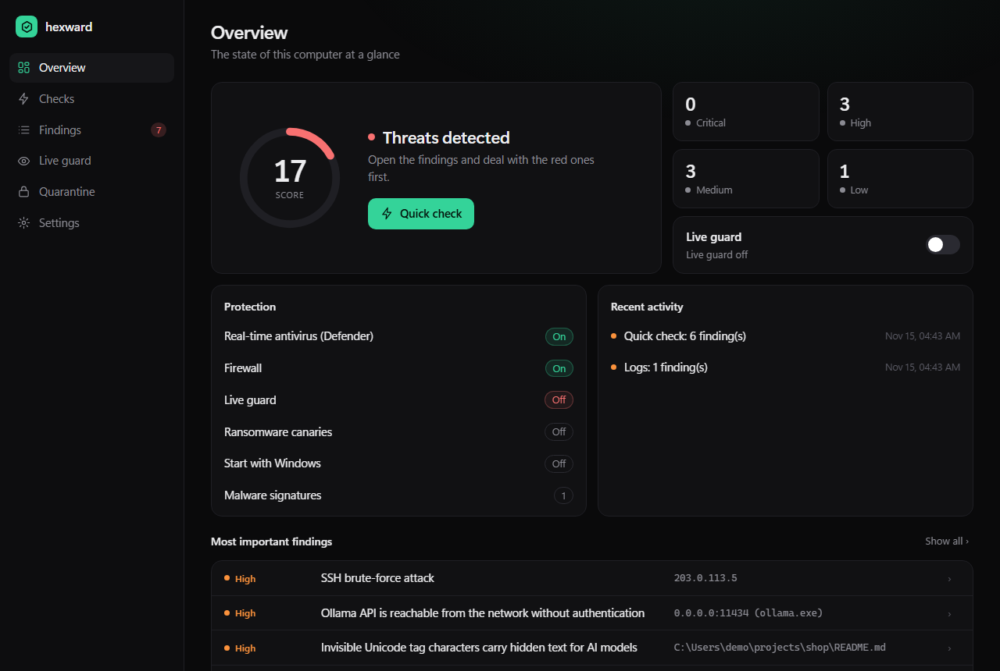

<p align="center">
  <a href="https://github.com/versex-arch/hexward">
    <picture>
      <source media="(prefers-color-scheme: dark)" srcset="docs/images/logo-dark.svg">
      
    </picture>
  </a>
  <br>
  <span>Find malware, break-in attempts, weak settings and AI agents with too much freedom on your computer, and see what to do about each one</span>
  <br>
</p>

<p align="center">
  <a href="#installation">Installation</a>
  &nbsp;&nbsp;&nbsp;•&nbsp;&nbsp;&nbsp;
  <a href="#usage">Usage</a>
  &nbsp;&nbsp;&nbsp;•&nbsp;&nbsp;&nbsp;
  <a href="docs/usage.md">Documentation</a>
  &nbsp;&nbsp;&nbsp;•&nbsp;&nbsp;&nbsp;
  <a href="CONTRIBUTING.md">Contributing</a>
  &nbsp;&nbsp;&nbsp;•&nbsp;&nbsp;&nbsp;
  <a href="README.ru.md">Русский</a>
</p>

<p align="center">
  <a href="https://github.com/versex-arch/hexward/actions/workflows/ci.yml"></a>
  
  
  <a href="LICENSE"></a>
</p>

<p align="center">
  <a href="docs/images/demo.png"></a>
</p>

## Installation

| Method | Notes |
|---|---|
| [Releases](https://github.com/versex-arch/hexward/releases) | Ready-made `hexward.exe` (window) and `hexward-cli.exe` (console) for Windows. Download and run |
| `pipx install git+https://github.com/versex-arch/hexward` | `pip` or `uv tool install` may be used in place of `pipx` |
| `git clone https://github.com/versex-arch/hexward && cd hexward && pip install .` | From source |

Requires Python 3.10+. No dependencies: the standard library is enough. The window opens in an app-style
Edge/Chrome window or your default browser, and is served only on `127.0.0.1` behind a per-run token.

> [!NOTE]
> The release builds are not code-signed yet. Windows SmartScreen: *More info → Run anyway*.
> If Smart App Control blocks `hexward.exe` or `pip.exe`, install from source with `python -m pip install .`
> and start it with `python -m hexward`.

## Usage

**Open the window**
```console
hexward
```

**Check everything at once: system, vulnerabilities, AI agents, risky folders**
```console
hexward quick
```

**Find brute force and web attacks in a log**
```console
hexward logs /var/log/auth.log access.log.gz
```

**Scan a folder for malware and quarantine signature matches**
```console
hexward scan ~/Downloads --quarantine
```

**Audit AI agents and scan a project for prompt injection**
```console
hexward ai ~/projects/shop --probe
```

**Watch agent configs, autostart, downloads and USB drives live**
```console
hexward guard init
hexward guard watch
```

**In CI: JSON report, fail on HIGH and above**
```console
hexward logs access.log --json -o report.json --fail-on high
```

```console
$ hexward --help
usage: hexward [-h] [--version] COMMAND ...

hexward v0.1.1: log analysis, malware scan, system audit, vulnerability scan, AI-agent guard.

positional arguments:
  COMMAND
    logs        analyze auth.log / nginx / apache logs
    winlog      analyze the Windows Security/System event logs
    scan        scan files for malware (signatures + heuristics)
    audit       audit persistence, security settings, processes, network
    harden      vulnerability scan: weak system settings, account problems, browser hijacks
    ai          AI-agent guard: exposed model servers, risky agent/MCP config, prompt injection
    quick       everything at once: audit + harden + ai + scan of risky folders
    guard       integrity baseline and live watch
    gui         open the desktop window
    autostart   start in the background when you sign in
    shortcut    put a desktop shortcut that opens the window without a console
    quarantine  manage quarantined files
    sigs        manage SHA-256 malware signatures

options:
  -h, --help    show this help message and exit
  --version     show program's version number and exit

Without a command the window opens. Nothing is deleted or changed without you asking:
checks only report, and quarantine is restorable.
Exit codes: 0 = clean, 1 = findings at or above --fail-on (default: medium), 2 = error.
```

The full reference (every check and rule, the AI-agent guard, start with Windows, performance, signatures,
how the window is protected, limitations) is in **[docs/usage.md](docs/usage.md)**.

## What it finds

| | |
|---|---|
| 🔑 **Break-in attempts** | SSH brute force, password spraying, distributed attacks, **a successful login after a brute force**, sudo abuse · failed Windows logons, cleared audit log, new users and services |
| 🌐 **Web attacks** | SQL injection, XSS, path traversal, command injection, Log4Shell · scanners and attack-tool User-Agents · login brute force, floods · secret files answered with HTTP 200 |
| 🦠 **Malware** | known files by SHA-256 · executables disguised as documents · packed PE files with injection APIs · obfuscated download-and-run scripts · ransomware and credential-dumping commands |
| 🪟 **System** | autostart entries, Startup scripts, Winlogon / IFEO / AppInit hijacks · Defender, firewall or UAC switched off · system-process impostors · suspicious scheduled tasks · hosts tampering |
| 🧱 **Vulnerabilities** | stored autologon password, WDigest, SMBv1, Secure Boot off, silent UAC, stale updates, Office macros enabled, accounts without a password · proxy, PAC and force-installed browser extensions |
| 🤖 **AI agents** | model servers reachable from the network · permission bypass and auto-approve switches · unpinned or plaintext MCP servers · secrets in agent configs · **prompt injection**: invisible Unicode, hidden HTML, poisoned rule files |
| 👁️ **Live guard** | changes to agent configs, shell profiles, SSH keys, hosts and autostart · new files in Downloads and on the Desktop · newly plugged USB drives · ransomware canaries |

Every finding has a level from **info** to **critical**, the evidence, and what to do about it, for example:
*"Successful SSH login as 'root' after 6 failed attempts — treat the account as compromised: rotate its
credentials, review its session history, and block the source address."*

The window is available in English, Russian, Kazakh, German, Spanish and Chinese.

## Disclaimer

```
hexward complements a real-time antivirus such as Microsoft Defender
and does not replace it: it has no kernel driver, does not block
programs from starting and does not scan memory. Heuristic findings
mean "look at this", not "this is malware". Checks only read; nothing
is removed unless you quarantine it, and quarantine can be restored.
Use it on computers and logs you own or are authorised to inspect.
The software is provided as is, without warranty of any kind.
```

## License

MIT © [versex-arch](https://github.com/versex-arch). See [LICENSE](LICENSE) and [SECURITY.md](SECURITY.md).
