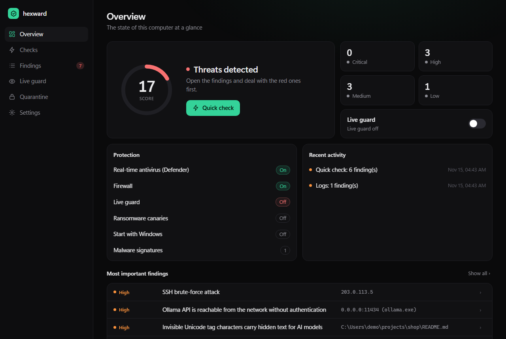

<p align="center">
  <a href="https://github.com/versex-arch/hexward">
    <picture>
      <source media="(prefers-color-scheme: dark)" srcset="docs/images/logo-dark.svg">
      
    </picture>
  </a>
  <br>
  <span>Поиск вредоносных файлов, попыток взлома, слабых настроек и ИИ-агентов с лишними правами на вашем компьютере: у каждой находки написано, что с ней делать</span>
  <br>
</p>

<p align="center">
  <a href="#установка">Установка</a>
  &nbsp;&nbsp;&nbsp;•&nbsp;&nbsp;&nbsp;
  <a href="#использование">Использование</a>
  &nbsp;&nbsp;&nbsp;•&nbsp;&nbsp;&nbsp;
  <a href="docs/usage.ru.md">Документация</a>
  &nbsp;&nbsp;&nbsp;•&nbsp;&nbsp;&nbsp;
  <a href="CONTRIBUTING.md">Участие</a>
  &nbsp;&nbsp;&nbsp;•&nbsp;&nbsp;&nbsp;
  <a href="README.md">English</a>
</p>

<p align="center">
  <a href="https://github.com/versex-arch/hexward/actions/workflows/ci.yml"></a>
  
  
  <a href="LICENSE"></a>
</p>

<p align="center">
  <a href="docs/images/demo.png"></a>
</p>

## Установка

| Способ | Примечания |
|---|---|
| [Releases](https://github.com/versex-arch/hexward/releases) | Готовые `hexward.exe` (окно) и `hexward-cli.exe` (консоль) для Windows. Скачайте и запустите |
| `pipx install git+https://github.com/versex-arch/hexward` | Вместо `pipx` можно `pip` или `uv tool install` |
| `git clone https://github.com/versex-arch/hexward && cd hexward && pip install .` | Из исходников |

Нужен Python 3.10+. Зависимостей нет — хватает стандартной библиотеки. Окно открывается как окно-приложение
Edge/Chrome или в браузере по умолчанию и доступно только на `127.0.0.1` по одноразовому токену.

> [!NOTE]
> Готовые сборки пока не подписаны. Windows SmartScreen: *Подробнее → Выполнить в любом случае*.
> Если Smart App Control блокирует `hexward.exe` или `pip.exe`, установите из исходников командой
> `python -m pip install .` и запускайте через `python -m hexward`.

## Использование

**Открыть окно программы**
```console
hexward
```

**Проверить всё сразу: систему, уязвимости, ИИ-агентов, опасные папки**
```console
hexward quick
```

**Найти брутфорс и веб-атаки в логе**
```console
hexward logs /var/log/auth.log access.log.gz
```

**Проверить папку на вредоносные файлы и отправить совпадения по сигнатурам в карантин**
```console
hexward scan ~/Downloads --quarantine
```

**Проверить ИИ-агентов и поискать prompt injection в проекте**
```console
hexward ai ~/projects/shop --probe
```

**Следить за конфигами агентов, автозагрузкой, загрузками и флешками в реальном времени**
```console
hexward guard init
hexward guard watch
```

**В CI: отчёт в JSON, ошибка при находках уровня HIGH и выше**
```console
hexward logs access.log --json -o report.json --fail-on high
```

```console
$ hexward --help
usage: hexward [-h] [--version] COMMAND ...

hexward v0.1.1: log analysis, malware scan, system audit, vulnerability scan, AI-agent guard.

positional arguments:
  COMMAND
    logs        analyze auth.log / nginx / apache logs
    winlog      analyze the Windows Security/System event logs
    scan        scan files for malware (signatures + heuristics)
    audit       audit persistence, security settings, processes, network
    harden      vulnerability scan: weak system settings, account problems, browser hijacks
    ai          AI-agent guard: exposed model servers, risky agent/MCP config, prompt injection
    quick       everything at once: audit + harden + ai + scan of risky folders
    guard       integrity baseline and live watch
    gui         open the desktop window
    autostart   start in the background when you sign in
    shortcut    put a desktop shortcut that opens the window without a console
    quarantine  manage quarantined files
    sigs        manage SHA-256 malware signatures

options:
  -h, --help    show this help message and exit
  --version     show program's version number and exit

Without a command the window opens. Nothing is deleted or changed without you asking:
checks only report, and quarantine is restorable.
Exit codes: 0 = clean, 1 = findings at or above --fail-on (default: medium), 2 = error.
```

Полный справочник (все проверки и правила, защита от ИИ-агентов, запуск вместе с Windows, скорость, сигнатуры,
защита окна программы, ограничения) — в **[docs/usage.ru.md](docs/usage.ru.md)**.

## Что находит

| | |
|---|---|
| 🔑 **Попытки взлома** | брутфорс SSH, перебор логинов, распределённые атаки, **успешный вход после брутфорса**, злоупотребление sudo · неудачные входы в Windows, очистка журнала аудита, новые пользователи и службы |
| 🌐 **Веб-атаки** | SQL-инъекции, XSS, обход каталогов, внедрение команд, Log4Shell · сканеры и User-Agent'ы атакующих утилит · брутфорс форм входа, флуд · секретные файлы, отданные с кодом 200 |
| 🦠 **Вредоносные файлы** | известные файлы по SHA-256 · исполняемые файлы под видом документов · упакованные PE с инъекцией в процессы · обфусцированные скрипты «скачай и запусти» · команды шифровальщиков и кражи паролей |
| 🪟 **Система** | автозагрузка, скрипты в Startup, подмена Winlogon / IFEO / AppInit · выключенные Defender, брандмауэр или UAC · процессы-самозванцы · подозрительные задачи планировщика · подмена hosts |
| 🧱 **Уязвимости** | пароль автовхода в реестре, WDigest, SMBv1, выключенный Secure Boot, UAC без запроса, давние обновления, разрешённые макросы Office, учётные записи без пароля · прокси, PAC-скрипт и принудительные расширения браузера |
| 🤖 **ИИ-агенты** | ИИ-серверы, доступные из сети · обход разрешений и автоподтверждение · MCP-серверы без закреплённой версии или по HTTP · секреты в конфигах агентов · **prompt injection**: невидимый Unicode, скрытый HTML, отравленные файлы правил |
| 👁️ **Слежение** | изменения конфигов агентов, профилей оболочки, SSH-ключей, hosts и автозагрузки · новые файлы в «Загрузках» и на рабочем столе · подключённые флешки · ловушки для шифровальщиков |

У каждой находки есть уровень от **info** до **critical**, доказательства и совет, что делать.

Окно программы переведено на английский, русский, казахский, немецкий, испанский и китайский.

## Дисклеймер

```
hexward дополняет антивирус с защитой в реальном времени, например
Microsoft Defender, и не заменяет его: в нём нет драйвера ядра, он не
блокирует запуск программ и не сканирует память. Эвристическая находка
означает «посмотри сюда», а не «это вирус». Проверки только читают;
ничего не удаляется, пока вы сами не отправите файл в карантин, а из
карантина файл можно восстановить. Проверяйте только свои компьютеры
и логи или те, на проверку которых у вас есть разрешение.
Программа предоставляется как есть, без каких-либо гарантий.
```

## Лицензия

MIT © [versex-arch](https://github.com/versex-arch). См. [LICENSE](LICENSE) и [SECURITY.md](SECURITY.md).
